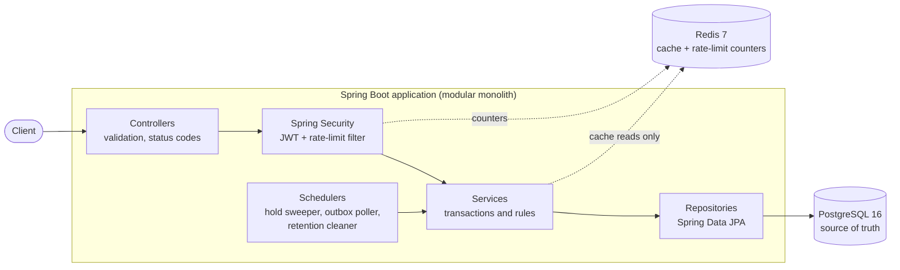
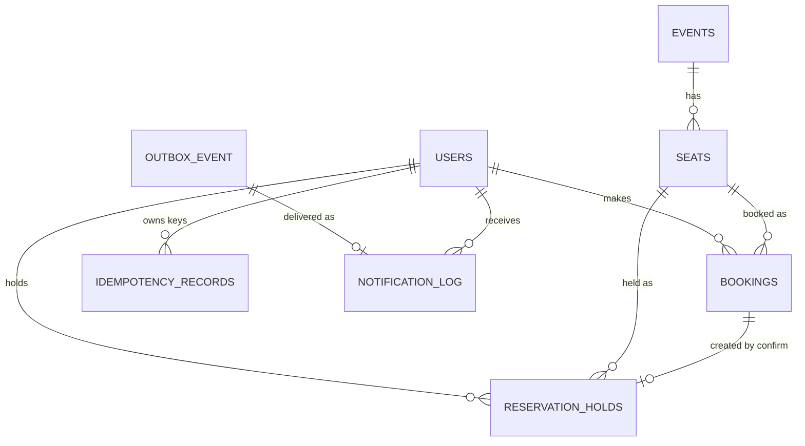
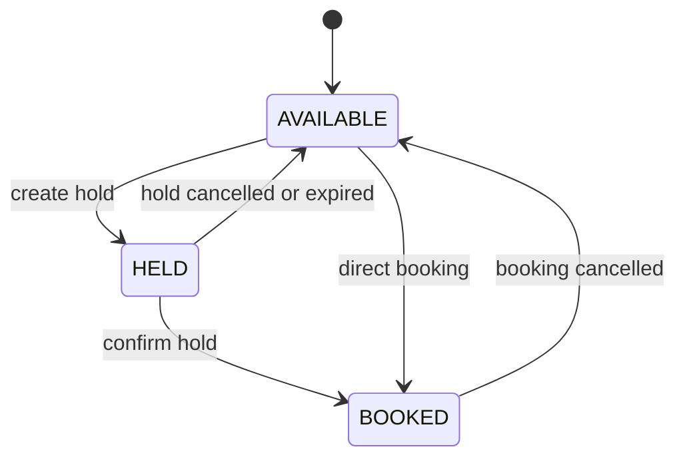
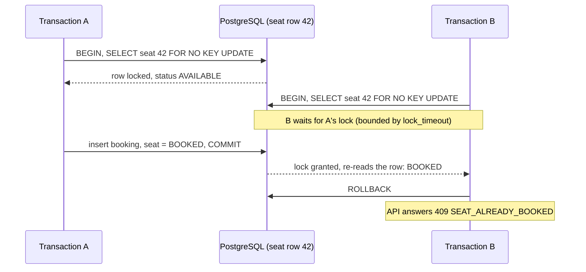
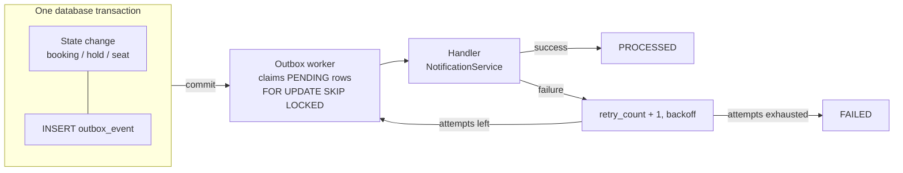

# Booking API with Safe Concurrency

A REST API for booking limited resources (event seats) that stays correct when many clients try to book the same seat at the same moment. It is a Spring Boot modular monolith backed by PostgreSQL, with Redis for caching and rate limiting and a transactional outbox for reliable side effects.

> **Deployment-ready; deployment intentionally not performed.** The project builds, tests and runs cleanly in Docker Compose, including under a production-like configuration. It has not been deployed to any hosting environment.

## Contents

1. [Overview](#1-overview)
2. [Key engineering highlights](#2-key-engineering-highlights)
3. [Problem statement](#3-problem-statement)
4. [Solution and architecture](#4-solution-and-architecture)
5. [Technology stack](#5-technology-stack)
6. [Domain model](#6-domain-model)
7. [Booking lifecycle and reservation holds](#7-booking-lifecycle-and-reservation-holds)
8. [Concurrency control](#8-concurrency-control)
9. [Idempotency](#9-idempotency)
10. [Redis: cache and rate limiting](#10-redis-cache-and-rate-limiting)
11. [Transactional outbox](#11-transactional-outbox)
12. [Security](#12-security)
13. [API reference](#13-api-reference)
14. [Error handling](#14-error-handling)
15. [Database design](#15-database-design)
16. [Observability](#16-observability)
17. [Testing](#17-testing)
18. [Project structure](#18-project-structure)
19. [Running the project](#19-running-the-project)
20. [Configuration](#20-configuration)
21. [Failure scenarios](#21-failure-scenarios)
22. [Design decisions and trade-offs](#22-design-decisions-and-trade-offs)
23. [Production hardening: what is implemented](#23-production-hardening-what-is-implemented)
24. [Known trade-offs](#24-known-trade-offs)
25. [Future improvements](#25-future-improvements)

---

## 1. Overview

Users browse events, then book seats. Seats are scarce, so many users will compete for the same one. The system guarantees that for any seat:

- at most one `CONFIRMED` booking exists,
- at most one active reservation hold exists,
- a booking or hold can never commit against an event that has already been cancelled,
- every state change produces exactly one outbox event, committed atomically with the change.

PostgreSQL enforces these guarantees with row locks and unique indexes. Redis is optional infrastructure that can be lost without affecting correctness.

## 2. Key engineering highlights

| Area | What it does |
| --- | --- |
| Safe concurrent booking | One transaction per booking: event row locked `FOR SHARE`, seat row locked, state verified under the locks. 50 simultaneous requests for one seat produce one success and 49 conflicts. |
| Defense in depth | Partial unique indexes make a second confirmed booking, or a second active hold, physically impossible even if application logic were wrong. |
| Bounded lock waits | A transaction-local PostgreSQL `lock_timeout` turns a stalled lock holder into a clean, retryable `503` instead of a hung request. |
| Reservation holds | Hold a seat for a configurable time, then confirm, cancel or let it expire. Expiry is both scheduled and lazy. |
| Idempotency | `Idempotency-Key` header; concurrent retries with one key create exactly one booking. |
| Redis cache | Event reads are cached cache-aside with a TTL and evicted after commit. Booking never reads the cache. |
| Distributed rate limiting | Atomic Lua fixed-window counter shared by all instances; `429` with `Retry-After`; proxy-aware client IP that cannot be spoofed by default. Fails open. |
| Transactional outbox | Events are written in the business transaction and delivered later, at-least-once, by a worker using `SKIP LOCKED`, with retries, backoff and retention. |
| Security | JWT (HS256, issuer and expiry validated), BCrypt, role and ownership checks, timing-safe login, restricted actuator. |
| Testing | 329 tests on real PostgreSQL and Redis (Testcontainers), including multi-threaded HTTP races, a randomized all-operations stress test, and two application instances sharing one database and one Redis. |
| Operations | Docker image (non-root), Compose with health checks, Flyway migrations, Micrometer business metrics, retention jobs. |

## 3. Problem statement

The classic race condition when checking and booking are separate steps:

```text
User A  -> reads seat 42 -> AVAILABLE
User B  -> reads seat 42 -> AVAILABLE
User A  -> books seat 42  -> OK
User B  -> books seat 42  -> OK        <-- double booking
```

Both reads happened before either write, so each request believed the seat was free. Checking in Java first (`if (seat.isAvailable())`) does not help because the check and the write are not one atomic step. An in-memory lock or `synchronized` only serialises requests inside one JVM, so it fails with two application instances. A cache or Redis flag adds a second system that can disagree with the data it is meant to protect.

## 4. Solution and architecture

The database makes the check-and-write atomic. A booking locks the seat row, checks it under the lock, and writes, in one transaction. Concurrent requests for the same seat queue on the row lock, and each one sees the committed result of the one before it.



Layers:

- **Controllers** translate HTTP to service calls and own validation and status codes. They never expose entities.
- **Services** own transaction boundaries and business rules. Booking, hold and event-cancellation logic lives here.
- **Repositories** are Spring Data JPA interfaces, including the locking queries (`FOR NO KEY UPDATE`, `FOR SHARE`, `SKIP LOCKED`).
- **Security** is a stateless JWT resource server plus a rate-limit filter that runs after authentication and before authorization.
- **Schedulers** run the hold-expiry sweeper, the outbox poller and the retention cleaner. All their state is in PostgreSQL, so any number of instances can run them.

## 5. Technology stack

| Technology | Version | Purpose |
| --- | --- | --- |
| Java | 21 | Language and runtime |
| Spring Boot | 3.5.16 | Web, Data JPA, Validation, Security, Actuator, scheduling |
| Hibernate / Spring Data JPA | via Spring Boot | Persistence and the locking queries |
| PostgreSQL | 16 | Source of truth: data, locks, constraints |
| Flyway | 11.7 | Versioned schema migrations |
| Redis (Lettuce client) | 7 | Event cache and rate-limit counters |
| Spring Security OAuth2 resource server | via Spring Boot | JWT (HS256) validation |
| BCrypt | via Spring Security | Password hashing |
| springdoc-openapi | 2.8.17 | OpenAPI document and Swagger UI |
| Micrometer / Actuator | via Spring Boot | Health and business metrics |
| JUnit 5, Mockito, AssertJ, Awaitility | via Spring Boot | Unit and integration tests |
| Testcontainers | 1.21.4 | Real PostgreSQL and Redis in tests |
| Maven (wrapper) | 3.9.16 | Build |
| Docker, Docker Compose | | Packaging and local environment |

## 6. Domain model



| Entity | Meaning |
| --- | --- |
| `User` | Account with a `USER` or `ADMIN` role and a BCrypt password hash |
| `Event` | Name, venue, date and time, status `SCHEDULED` or `CANCELLED`. Bookable only while `SCHEDULED` and in the future |
| `Seat` | Belongs to one event; status `AVAILABLE`, `HELD` or `BOOKED`. The seat row is the lock target |
| `Booking` | A user's claim on a seat; `CONFIRMED` or `CANCELLED`. Cancelled rows stay as history |
| `ReservationHold` | A temporary claim: `HELD`, `EXPIRED`, `CONVERTED` or `CANCELLED`, with an expiry time |
| `IdempotencyRecord` | Maps a user's `Idempotency-Key` to the booking it created |
| `OutboxEvent` | A business event awaiting delivery: `PENDING`, `PROCESSED` or `FAILED` |
| `NotificationLog` | One row per delivered outbox event; makes delivery idempotent |

## 7. Booking lifecycle and reservation holds

Seat states:



Hold states: `HELD` becomes `CONVERTED` (confirmed), `EXPIRED` (deadline passed) or `CANCELLED`. Finished holds are kept as history. Booking states: `CONFIRMED` becomes `CANCELLED`; a cancelled booking never blocks the seat from being booked again.

### Hold flow

1. `POST /api/v1/bookings/holds` with `eventId` and `seatId`. The user comes from the JWT.
2. In one transaction: lock the event row (`FOR SHARE`) and check it is open for booking, lock the seat row, check the seat belongs to the event.
3. If the seat is `HELD` by a hold whose deadline has passed, that hold is expired first (flushed immediately), so a lapsed hold never blocks a new one.
4. If the seat is not `AVAILABLE`, respond `409`. Otherwise mark it `HELD`, insert the hold with `expiresAt = now + hold duration` (default 300 seconds), record an outbox event, commit.
5. **Confirm** (`POST /bookings/holds/{id}/confirm`): hold owner only. Under the same locks it checks the hold is `HELD` and not past its deadline and the event is still open, then creates the booking, marks the hold `CONVERTED` and the seat `BOOKED`, atomically. A lapsed hold gives `409 HOLD_EXPIRED`; a finished hold gives `409 HOLD_NOT_ACTIVE`.
6. **Cancel** (`POST /bookings/holds/{id}/cancel`): owner or ADMIN. The hold becomes `CANCELLED` and the seat `AVAILABLE`.
7. **Expiry**: a scheduler (every 30 seconds by default) expires lapsed holds in bounded batches, one short transaction per hold. It takes the seat lock and re-checks the hold, so it can never expire a hold that was just confirmed. Expiry is also lazy (step 3), so correctness does not depend on the sweeper's timing.

A held seat is not listed as available and cannot be booked directly. Holds of an event that was cancelled can no longer be confirmed.

## 8. Concurrency control

### Why locking, and what is locked

Every operation that changes who owns a seat runs in a single database transaction (READ COMMITTED) and takes row locks in a fixed order:

| Operation | Locks taken, in order |
| --- | --- |
| Book a seat | idempotency key (if sent), event `FOR SHARE`, seat |
| Create hold | event `FOR SHARE`, seat |
| Confirm hold | event `FOR SHARE`, seat |
| Cancel hold, expire hold | seat |
| Cancel booking | booking, then seat |
| Update or delete event | event row (update lock), then its seats on delete (cascade) |

The seat and booking locks are Hibernate's pessimistic write lock, which it renders as `SELECT ... FOR NO KEY UPDATE` on PostgreSQL. That lock conflicts with itself, so concurrent transactions for one seat queue, while still allowing other transactions' foreign-key checks that reference the row.

No code path locks a seat first and then an event or an existing booking, so the lock graph has no cycles and cannot deadlock. If PostgreSQL still aborts a transaction as a deadlock victim, the API answers `409 CONCURRENT_MODIFICATION` and the client may retry.

### The booking race, step by step



B never sees the stale `AVAILABLE` state: after the lock is granted PostgreSQL re-reads the latest committed row. With 50 simultaneous requests, one commits and 49 are rejected.

### Bounded lock waits (`lock_timeout`)

A request that waits for a row lock holds a pooled database connection while it waits. If a transaction holding a lock stalled, every waiter would pile up behind it. To prevent that, booking, hold, cancellation and expiry transactions set PostgreSQL's `lock_timeout` as their first database call:

```sql
select set_config('lock_timeout', '3000ms', true)   -- true = local to this transaction
```

- **Scope.** The setting is transaction-local, so it never leaks to other users of a pooled connection and does not touch Flyway, startup, event updates, the outbox worker (which uses `SKIP LOCKED`) or the retention cleaner. It covers the idempotency-key wait as well.
- **Default and tuning.** `LOCK_TIMEOUT_MS`, default 3000 ms; 0 disables it. A legitimate wait is only the time the transactions queued ahead on the same seat need to finish, a few milliseconds each. The 50-way races against the Docker stack finished in under 0.5 seconds in total (slowest observed: 432 ms for all 50 requests), so 3 seconds leaves a wide margin, and it is shorter than the connection timeout (`DB_CONNECTION_TIMEOUT_MS`, default 5 s), so a lock stall surfaces as `RESOURCE_BUSY` rather than as pool exhaustion.
- **Outcome.** On expiry PostgreSQL raises SQLSTATE `55P03` and the whole transaction rolls back: no booking, hold, outbox event or idempotency record is written and the seat is unchanged. The API answers `503 RESOURCE_BUSY` with `Retry-After: 1` and no SQL detail. The client simply retries. A sweeper expiry that times out is logged and retried on the next sweep.

### Event cancellation race

Booking and hold transactions take the event row `FOR SHARE`. Many of them can hold it together, but an event update (for example setting it `CANCELLED`) needs an exclusive row lock, so it waits for in-flight transactions and blocks new ones until it commits. A booking therefore never commits against an event that has already been cancelled; it is rejected with `409 EVENT_NOT_BOOKABLE`.

### Second layer: constraints

| Constraint | Guarantee |
| --- | --- |
| `uq_bookings_confirmed_seat`: unique `(seat_id)` where `status = 'CONFIRMED'` | At most one confirmed booking per seat |
| `uq_holds_active_seat`: unique `(seat_id)` where `status = 'HELD'` | At most one active hold per seat |
| Foreign key `(seat_id, event_id)` to `seats (id, event_id)` | A booking or hold always references a seat of its own event |
| Check constraints | Only known statuses; `CONVERTED` holds must reference a booking |

A violation of either unique index is translated to `409`. With the locks in place these indexes never fire in normal operation; they exist so a bug cannot corrupt data.

### Multiple instances and restarts

No booking or hold state lives in application memory, and `synchronized`, in-process locks and Redis locks are deliberately not used. All instances sharing one PostgreSQL primary coordinate through its locks and constraints. The guarantee does not extend to multiple independent databases, writable replicas or sharding.

## 9. Idempotency

Clients retry requests when they time out. `POST /api/v1/bookings` accepts an optional `Idempotency-Key` header (1 to 255 printable characters, no spaces).

- The key is claimed first with `INSERT ... ON CONFLICT DO NOTHING` on `UNIQUE (user_id, idempotency_key)`.
- A repeated request with the same key and the same seat returns the **original booking with `200`** instead of `201`. The response reflects the booking's current state (so it shows `CANCELLED` if it was cancelled since).
- Concurrent retries serialise on the unique index: one creates the booking, the others wait and then receive the same booking. 20 concurrent retries create exactly one booking.
- The same key used for a different event or seat returns `422 IDEMPOTENCY_KEY_REUSED`.
- Keys are scoped per user. A request that fails (for example `409`) rolls back its key, so it can be retried with the same key.
- **Scope.** Only `POST /bookings` supports the header. Holds are not idempotent by key: a retried hold request gets `409` because the seat is already held, and a retried confirm gets `409 HOLD_NOT_ACTIVE`. Both are safe: nothing is duplicated.
- **Retention.** Keys are remembered for `IDEMPOTENCY_RETENTION_HOURS` (default 24) and then deleted by the retention cleaner. After that a retry of the same request is treated as a new request: if the seat is still taken it gets `409`, and the booking itself is never touched.

## 10. Redis: cache and rate limiting

Redis is used for two things only and is never consulted to decide who owns a seat.

### Event cache

- `GET /events/{id}` and `GET /events` are cached cache-aside, TTL 60 seconds by default.
- Event create, update (including cancellation) and delete evict the entry and every cached list page **after the transaction commits** (list pages are keyed by a version counter that is incremented).
- Seat lists and availability are never cached, and the booking and hold paths always read PostgreSQL.
- **Freshness contract.** Event reads are eventually fresh within the configured cache TTL, while booking correctness always comes from PostgreSQL. A read that races with a write can leave a stale entry for at most the TTL.

### Rate limiter

A fixed-window counter in Redis, incremented by a single Lua script, shared by every instance:

| Endpoint | Counted per | Default limit |
| --- | --- | --- |
| `POST /auth/login` | client IP | 10 per minute |
| `POST /auth/register` | client IP | 5 per minute |
| `POST /bookings` and `POST /bookings/holds` | authenticated user (one shared bucket) | 30 per minute |

Over the limit the response is `429` with the standard error body (`RATE_LIMITED`) and a `Retry-After` header holding the seconds left in the window. The filter runs after authentication (so per-user limits use the verified identity) and before authorization.

- **Atomic.** The increment, the expiry and the remaining-time lookup run in one Lua script, so concurrent requests cannot race on the counter (100 concurrent callers against a limit of 30 are admitted exactly 30 times).
- **No permanent keys.** The window starts at a client's first request and the key expires with it. The script also repairs a counter that exists without an expiry, so a client can never be locked out permanently.
- **Fixed-window trade-off.** Up to the limit is allowed per window, so a burst straddling a window boundary can briefly reach twice the limit. That is the accepted cost of a single atomic round trip; a sliding window would need more state per client.

### Client IP handling

The rate-limit identity for login and registration is the client address.

| Deployment | Behaviour |
| --- | --- |
| Direct (local development, Docker Compose) | The TCP peer address. `X-Forwarded-For` is **ignored**, so a client cannot choose its own bucket. This is the default. |
| Behind a reverse proxy you control | Set `FORWARD_HEADERS_STRATEGY=native` and `TRUSTED_PROXIES` to a regex matching the proxy's address. Tomcat then honours `X-Forwarded-For` only when the TCP peer matches, and uses the right-most address that is not itself a trusted proxy, so a prefix the client injected is ignored. |

The application never parses `X-Forwarded-For` itself. Whatever address results is validated as an IPv4 or IPv6 literal before it becomes part of a Redis key; anything else (a garbage header from a misconfigured proxy, for instance) falls into one shared `unknown` bucket, so it cannot create arbitrary keys. A too-broad `TRUSTED_PROXIES` (for example `.*`) lets any client spoof its address; a too-narrow one makes every client look like the proxy.

### Behaviour when Redis is unavailable

| Component | Behaviour |
| --- | --- |
| Event cache | Every cache failure is treated as a miss; reads fall back to PostgreSQL. Invalidation failures are logged and ignored. |
| Rate limiter | **Fails open**: requests are allowed and a warning is logged. Rate limiting is abuse protection; login and booking must stay available. |
| Booking and holds | Unaffected. They never use Redis. |
| Health | Redis is excluded from `/actuator/health` because the application degrades gracefully without it. |

Connection and command timeouts are 500 ms so an outage does not stall requests. Redis in Compose is memory-bounded (`maxmemory 128mb`, `volatile-lru`) and not persisted; every key the application writes has a TTL.

## 11. Transactional outbox

Without an outbox, a service that commits a booking and then notifies someone can lose the notification if it crashes in between, or notify about a booking that later rolled back. Here the event is written in the same transaction as the change:



- **Events**: `BOOKING_CONFIRMED`, `BOOKING_CANCELLED`, `RESERVATION_HELD`, `RESERVATION_CANCELLED`, `RESERVATION_EXPIRED`. Payloads contain business identifiers only (ids, seat number, status, expiry), never credentials or tokens.
- **Atomicity**: if the business transaction rolls back, so does its outbox row (tested by forcing a rollback).
- **Worker**: runs every 5 seconds, processes up to 50 due events per run, each in its own short transaction. `FOR UPDATE SKIP LOCKED` gives each event to one worker even with several instances.
- **Delivery semantics**: **at-least-once with idempotent handling**, not exactly-once. An event is marked `PROCESSED` only after its handler succeeds, so a crash causes a redelivery. The handler records one `notification_log` row per outbox event (unique key), so a redelivery has no second effect.
- **Failure handling**: a handler failure rolls back its work, increments `retry_count`, stores `last_error`, and reschedules with exponential backoff (5 s, doubling, capped at 5 minutes). After 5 attempts (configurable) the event is `FAILED`. A failing ("poison") event is retried on its own schedule and never blocks the other events in its batch. A failing handler never affects the booking, which has already committed.
- **Ordering.** Outbox delivery is at-least-once and does not guarantee global event ordering, and none is needed: each event is self-contained (it carries the identifiers and the resulting status), handlers are independent and idempotent, and no handler depends on an earlier event having been processed. No per-aggregate ordering is implemented.
- **Retention.** The retention cleaner (below) deletes `PROCESSED` events older than `OUTBOX_RETENTION_DAYS` (default 14) together with their notification rows. It never deletes `PENDING` events, including those waiting for a retry. `FAILED` events are kept for inspection unless `OUTBOX_FAILED_RETENTION_DAYS` is set.
- The handler only records a notification and writes a structured log line; there is no external delivery.

### Retention cleaner

One scheduled job (every `RETENTION_INTERVAL_MINUTES`, default 60) deletes finished rows so the outbox, notification and idempotency tables do not grow without bound. It deletes in batches of `RETENTION_BATCH_SIZE` (default 500), one short transaction per batch, skipping rows another instance holds (`SKIP LOCKED`), with an upper bound on batches per run. Several instances can run it safely. Each rule can be turned off with 0.

## 12. Security

| Topic | Implementation |
| --- | --- |
| Authentication | Stateless JWT (HS256). Signature, expiry and issuer are validated; forged, expired, wrong-issuer, edited-payload, `alg: none` and malformed tokens get `401`. Claims: subject = user id, `role`. Default lifetime 1 hour. |
| Role changes | The role is read from the signed token. A role change in the database applies to tokens issued afterwards; an existing token keeps its old role until it expires. A token cannot be edited to claim another role (the signature breaks). |
| Revocation | Not implemented: access tokens are stateless and are not individually revoked. Role and account-security changes may therefore require token expiry or re-authentication. To cut access sooner, shorten `JWT_EXPIRATION`, or rotate `JWT_SECRET`, which invalidates every outstanding token at the next restart. |
| Passwords | BCrypt. Rules: 8 to 72 characters, at least one letter and one digit, at most 72 UTF-8 bytes (BCrypt's input limit). Hashes are never returned. |
| Login | Unknown email and wrong password return the same `401`, and the same BCrypt work is done for both (no timing difference). BCrypt runs outside database transactions so it cannot exhaust the connection pool. |
| Authorization | `USER` books and holds; `ADMIN` manages events and seats. A booking is readable and cancellable by its owner or an ADMIN; a hold can be confirmed only by its owner and cancelled by its owner or an ADMIN. Identity always comes from the JWT, never from the request. |
| Public endpoints | `/api/v1/auth/**`, `/actuator/health/**`, Swagger UI and the OpenAPI document. Everything else needs a token. |
| Actuator | Only `health`, `info` and `metrics` are exposed. `metrics` is ADMIN only. Health shows no details. |
| CORS | Disabled unless `CORS_ALLOWED_ORIGINS` lists explicit origins; `*` is rejected at startup. |
| Secrets | Read from environment variables. The application refuses to start, naming the missing variables, if `DB_URL`, `DB_USERNAME`, `DB_PASSWORD`, `REDIS_HOST` or `JWT_SECRET` is absent. There is no default JWT secret or database password in any profile. |
| Errors and logs | No stack traces, SQL or class names in responses. Logs contain ids only, never passwords or tokens. |

## 13. API reference

All paths are under `/api/v1` unless stated. Interactive documentation: [Swagger UI](http://localhost:8080/swagger-ui.html) and the [OpenAPI document](http://localhost:8080/v3/api-docs) (when running locally).

| Method | Path | Auth | Purpose |
| --- | --- | --- | --- |
| POST | `/auth/register` | public | Create a `USER` account (`201`) |
| POST | `/auth/login` | public | Exchange credentials for a JWT |
| GET | `/users/me` | any user | Own profile |
| POST | `/events` | ADMIN | Create an event (`201`) |
| GET | `/events` | any user | List events by date, paged (cached) |
| GET | `/events/{eventId}` | any user | Get an event (cached) |
| PUT | `/events/{eventId}` | ADMIN | Update an event, including `status` |
| DELETE | `/events/{eventId}` | ADMIN | Delete an event with no bookings or holds (`204`); otherwise `409` |
| POST | `/events/{eventId}/seats` | ADMIN | Create up to 500 seats: `{"seatNumbers": ["A1", "A2"]}` (`201`) |
| GET | `/events/{eventId}/seats` | any user | List all seats, paged |
| GET | `/events/{eventId}/seats/available` | any user | List seats that can be booked |
| POST | `/bookings` | any user | Book a seat; optional `Idempotency-Key` (`201`, or `200` on replay) |
| GET | `/bookings/me` | any user | Own bookings, newest first, paged |
| GET | `/bookings/{bookingId}` | owner or ADMIN | Get a booking |
| POST | `/bookings/{bookingId}/cancel` | owner or ADMIN | Cancel a booking and release the seat |
| POST | `/bookings/holds` | any user | Hold a seat (`201`) |
| POST | `/bookings/holds/{holdId}/confirm` | hold owner | Convert the hold into a booking (`201`) |
| POST | `/bookings/holds/{holdId}/cancel` | owner or ADMIN | Cancel an active hold |
| GET | `/actuator/health` (not under `/api/v1`) | public | Health, plus `/liveness` and `/readiness` |
| GET | `/actuator/metrics/{name}` (not under `/api/v1`) | ADMIN | Business counters |

Paging uses `page` (default 0) and `size` (events 20, bookings 20, seats 50; maximum 100, 100 and 200). A page is `{content, page, size, totalElements, totalPages}`.

Hold request and response:

```json
{ "eventId": 1, "seatId": 101 }
```

```json
{ "holdId": 123, "eventId": 1, "seatId": 101, "seatNumber": "A1", "status": "HELD", "expiresAt": "2030-01-01T10:05:00Z" }
```

Booking response (`cancelledAt` appears only when cancelled):

```json
{ "id": 123, "eventId": 1, "seatId": 101, "seatNumber": "A1", "status": "CONFIRMED", "createdAt": "2030-01-01T10:00:00Z" }
```

### Example flow

```bash
BASE=http://localhost:8080/api/v1

# Local development profile only: log in as the seeded admin and user
ADMIN=$(curl -s $BASE/auth/login -H 'Content-Type: application/json' \
  -d '{"email":"admin@example.com","password":"Admin#12345"}' | jq -r .accessToken)
USER=$(curl -s $BASE/auth/login -H 'Content-Type: application/json' \
  -d '{"email":"user@example.com","password":"User#12345"}' | jq -r .accessToken)

# Admin creates an event and seats
EVENT=$(curl -s $BASE/events -H "Authorization: Bearer $ADMIN" -H 'Content-Type: application/json' \
  -d '{"name":"Jazz Night","venue":"Blue Hall","eventDateTime":"2030-06-01T19:00:00Z"}' | jq .id)
curl -s $BASE/events/$EVENT/seats -H "Authorization: Bearer $ADMIN" -H 'Content-Type: application/json' \
  -d '{"seatNumbers":["A1","A2"]}'

# User holds a seat, then confirms the hold within the hold duration
SEAT=$(curl -s $BASE/events/$EVENT/seats/available -H "Authorization: Bearer $USER" | jq '.content[0].id')
HOLD=$(curl -s $BASE/bookings/holds -H "Authorization: Bearer $USER" -H 'Content-Type: application/json' \
  -d "{\"eventId\":$EVENT,\"seatId\":$SEAT}" | jq .holdId)
curl -s -X POST $BASE/bookings/holds/$HOLD/confirm -H "Authorization: Bearer $USER"

# Or book directly; safe to retry with the same key
curl -s $BASE/bookings -H "Authorization: Bearer $USER" -H 'Content-Type: application/json' \
  -H 'Idempotency-Key: 7d1f3c52-4a0b-4f64-9f0e-0c6a1d9a2b11' \
  -d "{\"eventId\":$EVENT,\"seatId\":2}"
```

## 14. Error handling

Every error, including those produced by security filters and the rate limiter, has one JSON shape. Responses never include stack traces, SQL or class names.

```json
{
  "timestamp": "2030-01-01T10:00:00Z",
  "status": 409,
  "code": "SEAT_ALREADY_BOOKED",
  "message": "The requested seat is no longer available.",
  "path": "/api/v1/bookings"
}
```

Validation failures add a `details` array of `{field, message}`.

| Status | Meaning and codes |
| --- | --- |
| 400 | `VALIDATION_FAILED`, `MALFORMED_REQUEST` (bad JSON, wrong types, non-numeric or overflowing ids, bad paging) |
| 401 | `UNAUTHORIZED` (missing, malformed, expired, forged or wrong-issuer token), `INVALID_CREDENTIALS` |
| 403 | `FORBIDDEN` (not an admin, or not the owner) |
| 404 | `EVENT_NOT_FOUND`, `SEAT_NOT_FOUND`, `BOOKING_NOT_FOUND`, `HOLD_NOT_FOUND`, `USER_NOT_FOUND`, unknown path |
| 405, 415 | Wrong method; unsupported media type |
| 409 | `SEAT_ALREADY_BOOKED` (booked or held), `EVENT_NOT_BOOKABLE`, `HOLD_EXPIRED`, `HOLD_NOT_ACTIVE`, `BOOKING_ALREADY_CANCELLED`, `EVENT_HAS_BOOKINGS`, `SEAT_ALREADY_EXISTS`, `EMAIL_ALREADY_REGISTERED`, `CONCURRENT_MODIFICATION` (deadlock victim; retry), `DATA_CONFLICT` |
| 422 | `IDEMPOTENCY_KEY_REUSED` |
| 429 | `RATE_LIMITED`, with `Retry-After` |
| 503 | `RESOURCE_BUSY` (a row lock stayed busy past `lock_timeout`; `Retry-After: 1`; retry), `SERVICE_UNAVAILABLE` (PostgreSQL unreachable or the connection pool exhausted) |
| 500 | `INTERNAL_ERROR`: genuinely unexpected failures only |

## 15. Database design

| Table | Notes |
| --- | --- |
| `users` | Unique lower-case `email` (check constraint), `role` check |
| `events` | `status` check, index on `event_date_time` |
| `seats` | FK to events (cascade delete), `UNIQUE (event_id, seat_number)`, `UNIQUE (id, event_id)` (target of the composite FKs), status `AVAILABLE`/`HELD`/`BOOKED`, index `(event_id, status)` |
| `bookings` | FKs to user and `(seat_id, event_id)`, status check, `cancelled_at` consistent with status, partial unique index on confirmed seats, indexes on `(user_id, created_at desc)`, `event_id`, `seat_id` |
| `reservation_holds` | FKs to user, `(seat_id, event_id)` and booking; partial unique index on `HELD` per seat; partial index on `expires_at` for the sweeper; `booking_id` required exactly when `CONVERTED` |
| `idempotency_records` | `UNIQUE (user_id, idempotency_key)`, FK to the booking, index on `created_at` for retention |
| `outbox_event` | `jsonb` payload, status check, `retry_count >= 0`, `processed_at` required exactly when `PROCESSED`, partial indexes for due `PENDING` rows and for retention of `PROCESSED` and `FAILED` rows |
| `notification_log` | `UNIQUE (outbox_event_id)` |

Constraints complement the locks: the locks make correct behaviour the normal path, and the constraints make incorrect states impossible. Foreign keys to plain ids (rather than JPA associations) keep the booking path free of lazy-loading pitfalls while the database still enforces integrity.

**Migrations.** Flyway runs automatically at startup: `V1__create_schema.sql`, `V2__add_constraints_and_indexes.sql`, `V3__add_reservation_holds_and_outbox.sql`, `V4__add_retention_indexes.sql`. Applied migrations are never edited; changes go in a new version. Hibernate only validates the schema (`ddl-auto: validate`). A fresh database initialises from the migrations alone.

## 16. Observability

- `GET /actuator/health` (public, no details): reflects PostgreSQL. Liveness and readiness probes are at `/actuator/health/liveness` and `/readiness`. Redis is intentionally excluded.
- `GET /actuator/metrics/{name}` (ADMIN only). All counters are registered at startup:

| Metric | Meaning |
| --- | --- |
| `booking.success`, `booking.conflict` | Bookings confirmed; booking attempts rejected because the seat was taken |
| `reservation.hold.success`, `.conflict`, `.expired` | Holds created, rejected, expired |
| `rate_limit.exceeded` | Requests rejected with 429 |
| `cache.hit`, `cache.miss` | Event-cache lookups |
| `outbox.processed`, `outbox.failed` | Outbox events delivered; failed delivery attempts |
| `outbox.pending` (gauge) | Outbox events currently waiting |

Logs use structured `key=value` events (`booking.confirmed`, `hold.expired`, `retention.cleaned`, ...) and contain ids only.

## 17. Testing

`./mvnw clean verify` runs **329 tests, 0 failures, 0 errors, 0 skipped**. Integration tests start real PostgreSQL 16 and Redis 7 containers with Testcontainers (Docker must be running); tables and Redis are emptied before every test.

| Suite | Tests | What it covers |
| --- | --- | --- |
| Unit (`service`, `entity`, `exception`, `config`, `retention/RetentionCleanerTest`, `ratelimit/RateLimiterTest`, `ratelimit/ClientAddressTest`) | 118 | Booking and hold rules, authorization, lock-timeout ordering, idempotency, auth including the timing fix, outbox retry policy, error mapping (503 versus 409), rate limiter, client-address validation, required-settings check, deployment-configuration guards, retention logic |
| `repository` | 22 | Real PostgreSQL constraints, partial indexes, row-lock behaviour, V3 and V4 schema |
| `api` | 80 | Full HTTP stack: auth, roles, validation, error format, booking, hold and cancellation flows, idempotency, metrics, malformed and hostile requests, JWT role-change, tampering and `alg: none` behaviour |
| `cache` | 20 | Real Redis: hit, miss, configurable TTL and expiry, invalidation (update, cancel, delete, create), stale cache never affecting a booking, behaviour with Redis unreachable |
| `ratelimit` (integration) | 24 | Real Redis: boundaries, expiry, atomicity under 100 threads, repair of a missing expiry, `429`/`Retry-After`; client IP through real Tomcat for a direct client, spoofed header, malformed header, untrusted and trusted proxies |
| `outbox` | 14 | Atomic creation, rollback, processing, retry, exhaustion, a poison event not blocking its batch, idempotent redelivery, concurrent workers, bounded batches |
| `retention` (integration) | 8 | What is and is not deleted, bounded batches, concurrent cleaners, notification rows, idempotency keys forgotten and remembered |
| `concurrency` | 43 | Multi-threaded HTTP races, lock-timeout behaviour, a randomized all-operations stress test, and two application instances sharing PostgreSQL and Redis |

### Configuration guards

`DeploymentConfigurationTest` and `RequiredSettingsCheckTest` fail the build if a secret or connection setting gains a default, if the `dev` profile supplies a JWT secret or password, if demo data could be created outside the `dev` profile, if `.env.example` stops being placeholders, if the application container is pointed at a host-mapped port or `localhost` instead of `db` and `redis`, if the app stops waiting for healthy dependencies, or if the image stops running as a non-root user on Java 21. Missing required variables are reported by name at startup.

### Concurrency tests

They start the application on a random port and send real HTTP requests from many threads. A `CountDownLatch` releases all threads together so their transactions genuinely overlap; there are no sleeps. Scenarios:

| Scenario | Expected and verified |
| --- | --- |
| 50 users book 1 seat (repeated) | 1 `201`, 49 `409 SEAT_ALREADY_BOOKED`, 1 confirmed booking, seat `BOOKED` |
| 100 users across 10 seats | Each seat booked exactly once, no seat with two confirmed bookings |
| 50 users hold 1 seat (repeated) | 1 `201`, 49 `409`, 1 active hold |
| Holds and direct bookings mixed on one seat | Exactly one winner overall |
| 20 retries with one `Idempotency-Key` | 1 `201`, 19 `200`, 1 booking |
| 20 concurrent confirmations of one hold | 1 booking, 19 `409 HOLD_NOT_ACTIVE` |
| Concurrent expiry and concurrent sweeps | Each lapsed hold expired exactly once, one outbox event each |
| Confirmation racing expiry | A lapsed hold is never confirmed |
| 20 concurrent cancellations of one booking | 1 `200`, 19 `409` |
| Cancellation racing new bookings or holds | No `5xx`, seat state matches its bookings and holds |
| Booking or hold started while an event cancellation is uncommitted | Waits on the event lock, then `409 EVENT_NOT_BOOKABLE` (deterministic, detected through `pg_stat_activity`) |
| Event cancellation racing 30 bookings, and racing 30 holds | No deadlock, no `5xx`, outcomes consistent |
| Randomized stress: holds, bookings, confirms, both cancels, forced expiry, sweeps, event updates, outbox runs, all at once | No `5xx`; seat state consistent; exactly one outbox event per state change |
| A transaction stalls holding a seat lock (uncommitted `FOR UPDATE` in the test) | Booking, hold, confirm, hold-cancel, booking-cancel and an idempotency-key wait each give up with `503 RESOURCE_BUSY` and `Retry-After`; nothing is created or changed; the next request succeeds |
| A lock wait shorter than the timeout | The request succeeds (legitimate short contention is not failed) |
| 50 users split across two application instances sharing one database and one Redis | 1 winner, for bookings and for holds; an event update on one instance is visible through the other's cache |
| 12 login attempts and 8 booking attempts split across two instances with limits of 4 and 3 | Exactly 4 login attempts and 3 booking attempts admitted in total; the limit is the shared Redis counter, not per-instance memory |

### Docker verification

The same behaviour was verified against the real containers, using the Compose stack with the production profile (no `SPRING_PROFILES_ACTIVE`, demo data absent, admin created by the SQL promotion below): authentication and authorization, event cache and invalidation, booking, idempotent replay, holds including expiry by the sweeper, outbox draining, retention (old finished rows removed, pending and failed rows kept), metrics, a stalled PostgreSQL transaction turning into `503 RESOURCE_BUSY` after the lock timeout, `429` at the default limits including with spoofed `X-Forwarded-For` headers, and 50 concurrent HTTP requests against the application container (3 booking races and 3 hold races: each 1 success and 49 conflicts, confirmed directly in PostgreSQL). It also stopped Redis, and separately PostgreSQL, and checked the degraded behaviour in [Failure scenarios](#21-failure-scenarios).

## 18. Project structure

```text
.
├── Dockerfile                  multi-stage build, non-root runtime
├── docker-compose.yml          postgres, redis, app with health checks
├── .env.example                placeholders and tunables (copy to .env)
├── pom.xml, mvnw, mvnw.cmd     Maven build and wrapper
└── src
    ├── main
    │   ├── java/com/example/booking
    │   │   ├── BookingApplication.java
    │   │   ├── config/       properties records, metrics, scheduling, startup configuration check
    │   │   ├── controller/   Auth, User, Event, Seat, Booking, ReservationHold
    │   │   ├── dto/          request/response records, validation
    │   │   ├── entity/       JPA entities and status enums
    │   │   ├── exception/    ApiException, ErrorCode, GlobalExceptionHandler
    │   │   ├── repository/   Spring Data repositories and locking queries
    │   │   ├── service/      BookingService, ReservationHoldService, HoldExpirySweeper, LockTimeouts,
    │   │   │                 BookingPreconditions, BookingWriter, Event/Seat/Auth/UserService
    │   │   ├── security/     SecurityConfig, JWT issuing and conversion, 401/403 handlers
    │   │   ├── cache/        EventCache (Redis)
    │   │   ├── ratelimit/    RateLimiter (Lua), RateLimitFilter
    │   │   ├── outbox/       OutboxRecorder, OutboxProcessor, OutboxEventExecutor,
    │   │   │                 OutboxPoller, NotificationService
    │   │   ├── retention/    RetentionCleaner, RetentionBatches
    │   │   └── seed/         development-only demo data
    │   └── resources
    │       ├── application.yml, application-dev.yml
    │       └── db/migration/ V1, V2, V3, V4
    └── test
        ├── java/com/example/booking
        │   ├── api/, cache/, concurrency/, config/, entity/, exception/,
        │   │   outbox/, ratelimit/, repository/, retention/, service/
        │   └── IntegrationTestSupport.java   shared Testcontainers setup
        └── resources/application-test.yml
```

## 19. Running the project

### Prerequisites

- JDK 21
- Docker and Docker Compose (for the Compose setup and for the integration tests)
- Maven is not needed; the wrapper is included (`mvnw.cmd` on Windows)

### Run with Docker Compose

```bash
cp .env.example .env      # then edit POSTGRES_PASSWORD and JWT_SECRET
docker compose up --build
```

PostgreSQL and Redis start first; the application waits for both health checks, runs the Flyway migrations and becomes available on <http://localhost:8080>. Inside the Compose network the application talks to `db:5432` and `redis:6379`.

| Service | Container port | Host port (localhost only) |
| --- | --- | --- |
| Application | 8080 | 8080 (`APP_PORT`) |
| PostgreSQL | 5432 | 15432 (`DB_PORT`; 5432 is often taken) |
| Redis | 6379 | 16379 (`REDIS_HOST_PORT`; only needed to run the app from Maven) |

Check health at <http://localhost:8080/actuator/health>. Stop with `docker compose down`; add `-v` to delete the database volume.

### Run locally with Maven

```bash
cp .env.example .env
docker compose up -d db redis
set -a; . ./.env; set +a
DB_PASSWORD="$POSTGRES_PASSWORD" ./mvnw spring-boot:run
```

### Build and test

```bash
./mvnw test             # run the tests
./mvnw clean verify     # run the tests and package target/booking-api.jar
```

### Development profile versus production

`.env.example` sets `SPRING_PROFILES_ACTIVE=dev` so a local `docker compose up` gives a usable demo. **The `dev` profile is for local development only.**

| | `dev` profile | No profile (production) |
| --- | --- | --- |
| Demo accounts and sample event | Created on first start | Never created |
| `DB_URL`, `DB_USERNAME`, `REDIS_HOST` | Local defaults | Required |
| `DB_PASSWORD`, `JWT_SECRET` | Required | Required |
| CORS | `localhost:3000` and `localhost:5173` when `CORS_ALLOWED_ORIGINS` is unset | Only `CORS_ALLOWED_ORIGINS` |

The dev demo accounts are public in this repository (`admin@example.com` / `Admin#12345` and `user@example.com` / `User#12345`) and exist only under the `dev` profile. For any deployment other than your own machine leave `SPRING_PROFILES_ACTIVE` unset.

### Creating the first administrator

Registration always creates `USER` accounts, and there is deliberately no API or startup setting that grants `ADMIN`, so there is no default or bootstrap credential to leak. The first administrator is promoted directly in the database:

1. Register the account normally with `POST /api/v1/auth/register` (use a strong, unique password).
2. Promote it with SQL, from a trusted shell with database access:

   ```bash
   docker compose exec db psql -U "$POSTGRES_USER" -d "$POSTGRES_DB" \
     -c "UPDATE users SET role = 'ADMIN' WHERE email = 'you@example.com';"
   ```

   Against a managed database run the same `UPDATE` with your provider's SQL console or `psql`.
3. Log in again. The role is read from the token, so a token issued before the promotion is still a `USER` token.

Perform this over a trusted connection and never put database credentials, or this SQL with credentials, in the repository or in shell history that is shared. To demote an administrator run the same statement with `'USER'`; their existing tokens keep admin rights until they expire (see [Security](#12-security)).

## 20. Configuration

Copy `.env.example` to `.env`; never commit `.env`. The application and Compose read these variables:

| Variable | Required | Default | Purpose |
| --- | --- | --- | --- |
| `POSTGRES_DB`, `POSTGRES_USER` | Compose | `booking` | Database name and user |
| `POSTGRES_PASSWORD` | Compose | none | Database password |
| `JWT_SECRET` | yes | none | HS256 signing key, at least 32 characters |
| `JWT_EXPIRATION` | no | `1h` | Token lifetime |
| `DB_URL`, `DB_USERNAME`, `DB_PASSWORD` | yes (set by Compose) | none | Database connection when running the jar directly |
| `REDIS_HOST` | yes (set by Compose) | none | Redis host |
| `REDIS_PORT`, `REDIS_PASSWORD` | no | `6379`, empty | Redis port and optional password |
| `PORT` | no | `8080` | HTTP port inside the application |
| `DB_POOL_SIZE` | no | `10` | Connection pool size |
| `DB_CONNECTION_TIMEOUT_MS` | no | `5000` | How long a request waits for a connection before failing with `503` |
| `LOCK_TIMEOUT_MS` | no | `3000` | Longest a booking or hold waits for a row lock; 0 disables |
| `FORWARD_HEADERS_STRATEGY` | no | `none` | `native` only behind a proxy you control |
| `TRUSTED_PROXIES` | no | empty | Regex of trusted proxy addresses (with `native`) |
| `CORS_ALLOWED_ORIGINS` | no | empty | Comma-separated origins; empty disables CORS |
| `SPRING_PROFILES_ACTIVE` | no | none | `dev` for local development |
| `RESERVATION_HOLD_DURATION_SECONDS` | no | `300` | How long a hold lasts |
| `RESERVATION_EXPIRY_SWEEP_INTERVAL_SECONDS` | no | `30` | Hold sweeper period |
| `RESERVATION_EXPIRY_BATCH_SIZE` | no | `100` | Holds expired per sweeper batch |
| `EVENT_CACHE_TTL_SECONDS` | no | `60` | Event cache lifetime |
| `LOGIN_RATE_LIMIT_PER_MINUTE` | no | `10` | Login attempts per IP |
| `REGISTER_RATE_LIMIT_PER_MINUTE` | no | `5` | Registrations per IP |
| `BOOKING_RATE_LIMIT_PER_MINUTE` | no | `30` | Booking and hold requests per user |
| `OUTBOX_POLL_INTERVAL_SECONDS` | no | `5` | Outbox worker period |
| `OUTBOX_BATCH_SIZE` | no | `50` | Events processed per worker run |
| `OUTBOX_MAX_ATTEMPTS` | no | `5` | Deliveries before an event is `FAILED` |
| `OUTBOX_RETENTION_DAYS` | no | `14` | Age at which `PROCESSED` outbox events are deleted; 0 disables |
| `OUTBOX_FAILED_RETENTION_DAYS` | no | `0` | Age at which `FAILED` events are deleted; 0 keeps them |
| `IDEMPOTENCY_RETENTION_HOURS` | no | `24` | How long idempotency keys are remembered; 0 disables |
| `RETENTION_BATCH_SIZE`, `RETENTION_INTERVAL_MINUTES` | no | `500`, `60` | Retention batch size and period |
| `APP_PORT`, `DB_PORT`, `REDIS_HOST_PORT` | no | `8080`, `15432`, `16379` | Host port mappings (Compose) |

Compose forwards the tuning variables above to the application, except `PORT` (fixed at 8080 in the image) and `REDIS_PASSWORD` (the bundled Redis has no password), and sets the in-network hosts (`db`, `redis`) and ports itself, so the host port mappings are never used for container-to-container traffic.

## 21. Failure scenarios

| Scenario | What happens |
| --- | --- |
| Two users book the same seat | One gets `201`; the other `409 SEAT_ALREADY_BOOKED`. |
| Duplicate request (client retry) | With the same `Idempotency-Key`: the original booking is returned with `200`. Without a key: the second request gets `409`. |
| Hold expires | The sweeper (or the next transaction on that seat) marks it `EXPIRED`, the seat becomes `AVAILABLE`, and `RESERVATION_EXPIRED` is recorded. Confirming it gives `409 HOLD_EXPIRED`. |
| Event is cancelled | New bookings and holds, and confirmations of existing holds, get `409 EVENT_NOT_BOOKABLE`. Existing confirmed bookings are kept. |
| User lacks permission | `403` for the wrong role or someone else's booking or hold; `401` without a valid token. |
| A transaction stalls while holding a seat lock | Requests for that seat wait up to `LOCK_TIMEOUT_MS`, then fail with `503 RESOURCE_BUSY` and `Retry-After`, with nothing written. Other seats are unaffected. Once the stalled transaction ends the same request succeeds. |
| Redis is unavailable | Event reads come from PostgreSQL, rate limiting allows requests, booking and holds are unaffected, and health stays `UP`. When Redis returns, caching and limits resume without a restart. |
| PostgreSQL is unavailable | Requests that need the database fail fast (within seconds) with `503 SERVICE_UNAVAILABLE`; cached event reads keep working; health reports `DOWN`. The application reconnects by itself when the database returns. |
| Outbox handler fails | The booking stays committed; the event is retried with backoff and ends `PROCESSED` or, after the attempt limit, `FAILED`. |
| Transaction aborted as a deadlock victim | `409 CONCURRENT_MODIFICATION`; retry. |
| Too many requests | `429` with `Retry-After`. |

## 22. Design decisions and trade-offs

- **PostgreSQL row locks, not optimistic versioning.** Contention on a popular seat is expected, so waiting briefly on a lock is cheaper and simpler than retry loops after version conflicts. Locks and constraints live next to the data and commit and roll back with it.
- **A bounded lock wait instead of an unbounded one.** Waiting is the design, but waiting forever behind a stalled transaction would tie up connections and turn one problem into an outage. A transaction-local timeout bounds the damage without changing behaviour in the normal case.
- **Redis does not decide booking correctness.** A separate system holding the truth about seats could disagree with the database or fail independently. Redis holds only data that can be lost without harm (cached reads and counters).
- **Cache event reads, not seat availability.** Event details change rarely and are read constantly. Availability changes with every booking, and a stale answer would mislead users, so it always comes from PostgreSQL.
- **Rate limiting fails open, and trusts no header by default.** It is abuse protection; blocking logins and bookings because a counter store is down would be a worse failure than briefly not limiting. Client addresses come from the TCP peer unless an operator names a trusted proxy.
- **Lazy plus scheduled hold expiry.** Correctness comes from the seat lock, so the sweeper only has to keep data tidy.
- **Transactional outbox.** The event commits with the change and is delivered afterwards, so a slow or failing consumer can never fail or roll back a booking, and no event is lost on a crash.
- **Retention is deletion of finished rows only.** Pending and retryable events and bookings are never touched, and failed events are kept unless configured otherwise.
- **Modular monolith.** One deployable unit gives transactional consistency across seats, holds, bookings and outbox rows with no distributed transactions. The package boundaries keep it splittable if it ever needs to be.
- **No Kafka or message broker.** The outbox table and worker give reliable at-least-once delivery for the one consumer that exists, with no extra infrastructure.
- **No admin-management subsystem.** Promoting the first administrator by SQL avoids a bootstrap credential that could leak.
- **Testcontainers.** Locking, partial indexes, lock timeouts and `SKIP LOCKED` are PostgreSQL behaviour; mocks or an in-memory database cannot prove them.
- **Events with bookings or holds are not deleted.** They are set to `CANCELLED`, which keeps history intact.
- **HTTP semantics.** `409` for state conflicts, `403` for someone else's resource, `422` for a reused idempotency key, `429` when rate limited, `503` when a lock stayed busy or the database is unreachable.

## 23. Production hardening: what is implemented

| Concern | Mechanism | Configuration |
| --- | --- | --- |
| Stalled lock holders | Transaction-local `lock_timeout` on booking, hold, cancel and expiry transactions; `503 RESOURCE_BUSY` with `Retry-After` | `LOCK_TIMEOUT_MS` |
| Connection starvation | Connection timeout so an outage or exhausted pool fails in seconds; BCrypt kept out of transactions | `DB_CONNECTION_TIMEOUT_MS`, `DB_POOL_SIZE` |
| Rate-limit correctness | Atomic Lua script, guaranteed expiry, repair of a missing expiry, `Retry-After` from the remaining window | rate-limit variables |
| Client identity | TCP peer by default; explicit trusted-proxy list; validation before use in a Redis key | `FORWARD_HEADERS_STRATEGY`, `TRUSTED_PROXIES` |
| Unbounded tables | Retention cleaner for processed outbox events, optional failed events, and idempotency keys | `OUTBOX_RETENTION_DAYS`, `OUTBOX_FAILED_RETENTION_DAYS`, `IDEMPOTENCY_RETENTION_HOURS` |
| Poison events | Per-event failure isolation, backoff, attempt limit, `FAILED` state | `OUTBOX_MAX_ATTEMPTS` |
| Unbounded Redis memory | `maxmemory` with `volatile-lru`; all keys carry a TTL | Compose |
| Misconfiguration | Startup check naming missing variables; guard tests for defaults, secrets and Docker networking | n/a |
| Account enumeration | Constant-work login | n/a |

## 24. Known trade-offs

These are deliberate choices with their reasons, not defects.

- **Fixed-window rate limiting.** A burst across a window boundary can reach twice the limit. A sliding window would cost more state per client.
- **Rate limiting fails open** when Redis is down, because availability of login and booking matters more than abuse protection during an outage.
- **Cached event reads can be stale for up to the TTL** (60 seconds by default). Booking decisions never use the cache.
- **A lock timeout is a client-visible `503`.** The alternative, waiting indefinitely, is worse. Clients are expected to retry.
- **Outbox delivery is at-least-once with no ordering guarantee**, and the handler only records and logs a notification; there is no external delivery channel.
- **Retention forgets.** After `IDEMPOTENCY_RETENTION_HOURS` a very late retry is treated as a new request; processed outbox rows disappear after their retention. Both are configurable.
- **Idempotency covers `POST /bookings` only.** Holds and confirmations are safe to retry (they return `409`) but are not deduplicated by key.
- **Stateless JWTs are not revocable.** A role change or an account-security change takes effect when the token expires or the user logs in again. The emergency lever is rotating `JWT_SECRET`.
- **The first administrator is created with SQL**, by design (see above).
- **Client IP behind a proxy depends on correct `TRUSTED_PROXIES`.** Misconfiguring it either lets clients spoof their address or groups all clients under the proxy's address.
- **Correctness assumes a single PostgreSQL primary.** The multi-instance tests run two application instances in one JVM against one real PostgreSQL and one real Redis, not on separate hosts.
- **Swagger UI and the OpenAPI document are public**; block them at a proxy if the API should not describe itself. Metrics are available through Actuator only, not in Prometheus format.

## 25. Future improvements

- A real notification channel behind the outbox.
- Refresh tokens and token revocation, if the threat model requires it.
- A sliding-window rate limiter if boundary bursts become a problem.
- Multi-host load and failover testing, and a deployment pipeline (CI build, image publishing) once a target environment is chosen.
